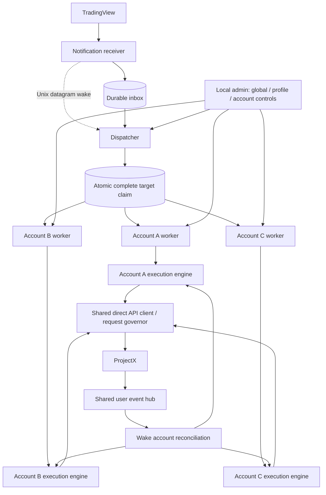

# Architecture

Two native processes run on the operator's laptop. `cmd/webhook` validates bounded JSON and commits notifications to SQLite. `cmd/bot` owns all ProjectX connectivity, local administration, account runners and recovery. The receiver has no trading client or ProjectX credentials. The dashboard binds to 127.0.0.1:8080; notification ingress binds to 127.0.0.1:8090. Any configured delivery tunnel targets ingress only. Trading REST/WebSocket connections are direct, without HTTP proxies or redirect following. Provider permission for a remote signal workflow remains the operator's responsibility.

## Routing and ownership

A profile selects one Trade Manager, strategy, supported instrument, pinned contract and Market/Limit entry type. A Trade Manager has one or up to 20 explicit account targets. Multiple profiles run concurrently when their targets do not overlap. A running profile reserves every target atomically in memory; a conflict rejects Start before any target is assigned. One account has one active/uncertain intent, enforced by SQLite. Account ownership remains while an order is working, a position exists or reconciliation is unresolved, including after Pause. Manual Practice tests use the same engine implementation with separate recovery scope and cannot share an automatic account.

Each delivery freezes its complete routing/policy snapshot in `target_jobs` in `execution.db` before any worker runs. IDs are deterministic hashes of profile, original delivery ID and account. Per-account sizing and submission are independent. A failed target does not roll back another account's accepted order. The original alert ID connects the fanout records; each engine gets a distinct durable intent and broker customTag. Saved configuration never silently reduces the routing set to one account.

Queues hold at most one delivery per account, with a busy gate. Alerts arriving while busy, disarmed, paused, before Start/session authorization, or outside the exact configured scope are consumed with visible blocked outcomes. They are never held until trading becomes possible. Startup consumes interrupted claims, recovers account intents, and restores neither Start nor placement. Reconciliation owns ambiguous writes; no speculative retries occur.

## Latency and shared connectivity

After a successful inbox transaction, the receiver sends one byte to a private Unix datagram socket (`inbox.sock`, mode 0600 in the 0700 state directory). This notification contains no signal or authorization. The dispatcher wakes immediately and reads SQLite. Duplicate and rejected requests do not notify. A 30-second scan recovers lost notifications; a bounded wake channel coalesces bursts. No new service, socket configuration, message broker or Unix socket forwarding is required.

Per-account network work runs outside the coordinator/configuration mutex. One slow account cannot serialize all others. Contract metadata, account eligibility, positions and working orders are retrieved concurrently before entry. Account/exposure checks remain fresh. Contract metadata alone has a bounded one-minute, singleflight cache. JWT renewal and HTTP connections are shared. Quote subscriptions are reference counted per contract and warmed when arming, avoiding duplicate streams and initial subscription setup on the alert path.

A shared user-data SignalR connection subscribes to Accounts and each runner's Orders, Positions and Trades. Subscription acknowledgements determine connection readiness. Events wake the corresponding REST reconciler; reconnect restores subscriptions and wakes all runners for full checks. Event payloads do not establish flatness or directly authorize placement. The implementation uses the documented SignalR JSON subset over maintained Gorilla WebSocket, with bounded frames, Bearer headers and capped exponential backoff. It does not implement every SignalR transport.

REST remains authoritative and provides a polling backstop. Automatic active reconciliation is paced at `max(5 seconds, 3 seconds × accounts with active intents)`, with immediate placement wake and user-event wakes coalesced per account to one second. Manual test reconciliation remains every two seconds while active. Idle engines perform no exposure polling. The discovery refresh interval is separate and does not schedule alert dispatch.

The documented REST ceiling is 200 requests/60 seconds. The shared governor permits at most 180, with reads capped at 140 and eight requests in flight. The remaining capacity is available to mutations; this is a reserve, not a guarantee during network/provider outages. Rate-budget waits are cancellable. Large fanouts and frequent updates can delay/reject fresh preflight checks rather than bypass them. Other applications using the same API credentials are outside this local governor.

## Persistence, administration and recovery

SQLite uses prepared statements, FULL synchronous transactions and serialized local access. `remote-alerts.db` stores notifications, `signals.db` review history, `execution.db` intents/locks/fanout/global pause, and `activity.db` sanitized logs. `automation-setups.json` stores independent profile settings. Identity, bracket/protection, emergency mutation latches and session locks survive restart. The legacy global active-intent index is removed automatically while the per-account index remains. The native execution lease is acquired before workers or listeners.

The dashboard provides profile Start/Pause, per-account monitoring/control, global entry pause/resume and password-confirmed flatten actions. Global pause persists; Resume only clears that gate and never starts profiles. Global flatten includes automatic runners and active manual recovery. Flatten requests require later flatness verification. Pausing cancels preflight work and prevents new dispatch. An attempt already durably reserved for submission can complete its bounded one-time request; Pause cannot recall it. Existing protection and reconciliation continue.

Basic authentication uses the private administrator store, bcrypt and CSRF/exact-origin validation. Privileged setup and emergency actions recheck the password. Existing administrator stores override bootstrap credentials. Receiver sandboxing excludes private setup/credential files. No credentials, raw signal payloads or provider bodies enter logs.

## Scope and limits

Automatic support includes API-verified simulated Practice, Trading Combine and Express Funded accounts; official API access excludes Live Funded. Manual API test tickets remain PRAC-only. Continuous calendar support is bounded to reviewed 2026 MNQ/MGC sessions; merged holiday sessions and unknown calendar periods are denied. All entry engines enforce operation days, configured news rules, risk, fresh data, authoritative account permission, Auto OCO and reconciliation.

Per-trade-only managers enforce planned risk independently per account and do not enforce MLL, account floors or an aggregate portfolio cap. Multi-account managers require this policy; legacy fixed-floor policies remain single-account. Twenty targets per manager is the explicit bounded fanout limit. Server-side brackets remain essential during laptop outages. Broker acceptance is not fill or protection, and fanout cannot guarantee simultaneous fills.

Still outside implemented scope: automatic MLL discovery, paper simulation, local strategy generation, arbitrary order modification/trailing, calendars beyond reviewed coverage and guaranteed provider latency. See [automatic setup](automatic-execution.md), [API evidence](projectx-api.md), [risk](risk-management.md) and [recovery](recovery-procedures.md).
